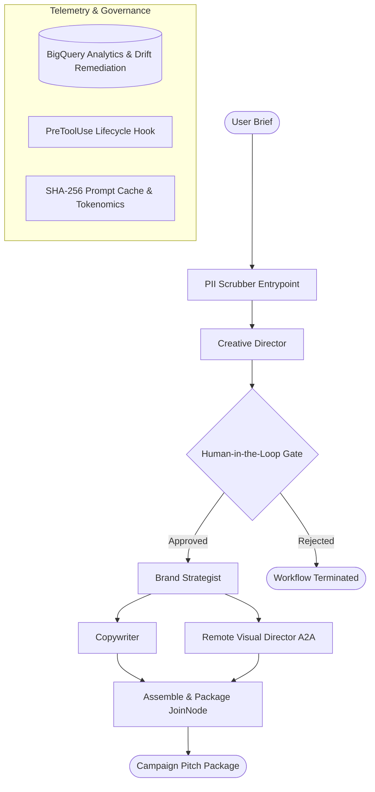

# Agentic Pitch Generator (Build With Gemini)

An enterprise multi-agent campaign pitch generation platform powered by Google Gemini, Google Agent Development Kit (ADK), BigQuery Analytics, Human-in-the-Loop governance, and tokenomics context optimization.

[](https://cloud.google.com/vertex-ai)
[](https://deepmind.google/technologies/gemini/)
[](https://fastapi.tiangolo.com)
[](LICENSE)

---

## Architecture Overview

The system coordinates specialized autonomous AI agents to transform raw product briefs into cohesive, brand-aligned marketing campaigns.



### Specialist Agent Roles

| Specialist | Model | Responsibility | Output / Artifact |
| :--- | :--- | :--- | :--- |
| **Creative Director** | `gemini-3.8-flash` | Synthesizes product briefs into a punchy concept line and strategic rationale | `ConceptPayload` |
| **Human Approval** | ADK `@node` | Pauses workflow for human authorization before downstream resource dispatch | Approved Markdown |
| **Brand Strategist** | `gemini-3.8-flash` | Formulates target audience personas, positioning, and brand voice | Strategic narrative |
| **Copywriter** | `gemini-3.8-flash` | Crafts high-impact social captions (< 25 words) with energetic CTAs | `CopyPayload` |
| **Visual Director** | Remote A2A | Generates brand-compliant art direction and photorealistic key visual imagery | PNG Key Visual (`ImageBlob`) |

---

## Core Capabilities

### 1. Agent-to-Agent (A2A) Microservices
- Implements the **A2A protocol** via `.well-known/agent-card.json`.
- The `visual_director` operates as an independent microservice callable locally (`port 8801`) or deployed to Cloud Run with automatic OIDC service-to-service authentication.

### 2. Enterprise Governance & Security
- **PreToolUse Lifecycle Hook**: Enforces a strict tool allowlist (`load_skill`, `generate_key_visual`), blocks prompt injections (`"ignore previous instructions"`, `<system>` tags), path traversal attempts, and payload attacks > 4096 characters.
- **Sensitive PII Scrubber**: Automatically detects and redacts emails, phone numbers, SSNs, credit cards, and API secrets across text and nested JSON payloads before reaching model context or telemetry logs.
- **Human-in-the-Loop (HITL) Gate**: Uses ADK two-node pause/resume semantics (`rerun_on_resume=False` on input collection, `rerun_on_resume=True` on validation). Fails closed on rejection with zero downstream LLM calls.

### 3. BigQuery Analytics & Closed-Loop Drift Remediation
- **Event Streaming**: Streams live agent execution telemetry (session ID, latency, token consumption, status) into BigQuery table `bwg.agent_events`.
- **Object Table Integration**: References generated campaign visuals in Cloud Storage using `OBJ.MAKE_REF` and `OBJ.FETCH_METADATA` within `bwg.key_visuals`.
- **Continuous Brand Compliance**: Evaluates visual prompts against house brand guidelines using BigQuery ML `AI.SCORE`. Detects drifted records (< 7.0) and automatically tunes prompts back to compliance (>= 7.0).

### 4. Tokenomics Context Optimization
- **Memory Compression**: Summarizes older conversation turns into synthetic system turns while preserving the most recent 2 turns verbatim.
- **Sliding-Window Pruning**: Bounded by max turn limits and strict token budgets with automated oversized turn truncation (`truncated=True`).
- **SHA-256 Prompt Caching**: Computes 64-character hex hash keys with TTL tracking for static brand guidelines, turning prompt cache misses into 100% token savings on repeated turns.
- **Tiered Model Routing**: 5-tier strategy manager (`flash`, `pro`, `low`, `high`, `local`) balancing cost, latency, and reasoning depth.

---

## Project Structure

```text
.
├── pitch_generator/
│   ├── agent.py               # Specialist agents, HITL gate, security hooks, tokenomics
│   ├── fast_api_app.py        # Web server & API routing (A2A, HITL, artifacts)
│   ├── config.py              # Configuration & environment variable bindings
│   ├── skills/                # On-demand modular agent skills
│   │   └── brand-guidelines/  # House brand guidelines (palette, lighting, styling)
│   ├── app_utils/             # Runtime clients, memory bank, A2A protocol helpers
│   └── sql/                   # BigQuery DDL, object table creation, and AI.SCORE queries
├── frontend/                  # Web UI (HITL approval card, campaign grid, telemetry trace)
├── scripts/
│   ├── setup.sh               # Provisions BigQuery, Cloud Storage, and IAM bindings
│   └── deploy.sh              # Cloud Run multi-service deployment script
├── tests/                     # Comprehensive offline test suites (Modules 1 - 4)
├── call_agent.py              # Canonical CLI testing entrypoint
├── Dockerfile                 # Container image specification
└── pyproject.toml             # Python packaging & dependencies
```

---

## Getting Started

### Prerequisites
- Python 3.10+
- Google Cloud SDK (`gcloud`) authenticated with a project having Vertex AI and BigQuery APIs enabled.

### Local Setup

1. **Clone the repository**:
   ```bash
   git clone https://github.com/Weile0409/buildwithgemini-agentic-pitch-generator.git
   cd buildwithgemini-agentic-pitch-generator
   ```

2. **Install dependencies**:
   ```bash
   pip install -e .
   ```

3. **Configure environment**:
   ```bash
   cp .env.example .env
   # Edit .env with your GCP project details:
   # PROJECT_ID=your-gcp-project-id
   # REGION=us-central1
   ```

4. **Start the local services**:
   ```bash
   bash .agents/skills/start-frontend/scripts/start_server.sh --with-visual-director
   ```
   - Pitch Generator Frontend: [http://localhost:8080](http://localhost:8080)
   - Visual Director A2A Agent Card: [http://localhost:8801/.well-known/agent-card.json](http://localhost:8801/.well-known/agent-card.json)

---

## Testing & CLI Invocations

Run the multi-agent pitch generator via CLI:
```bash
python3 call_agent.py "Flying skateboards for cats"
```

Execute the comprehensive offline test suites:
```bash
pytest tests/test_module_1.py
pytest tests/test_module_2.py
pytest tests/test_module_3.py
pytest tests/test_module_4.py
```

---

## License

This project is licensed under the Apache 2.0 License - see the [LICENSE](LICENSE) file for details.
